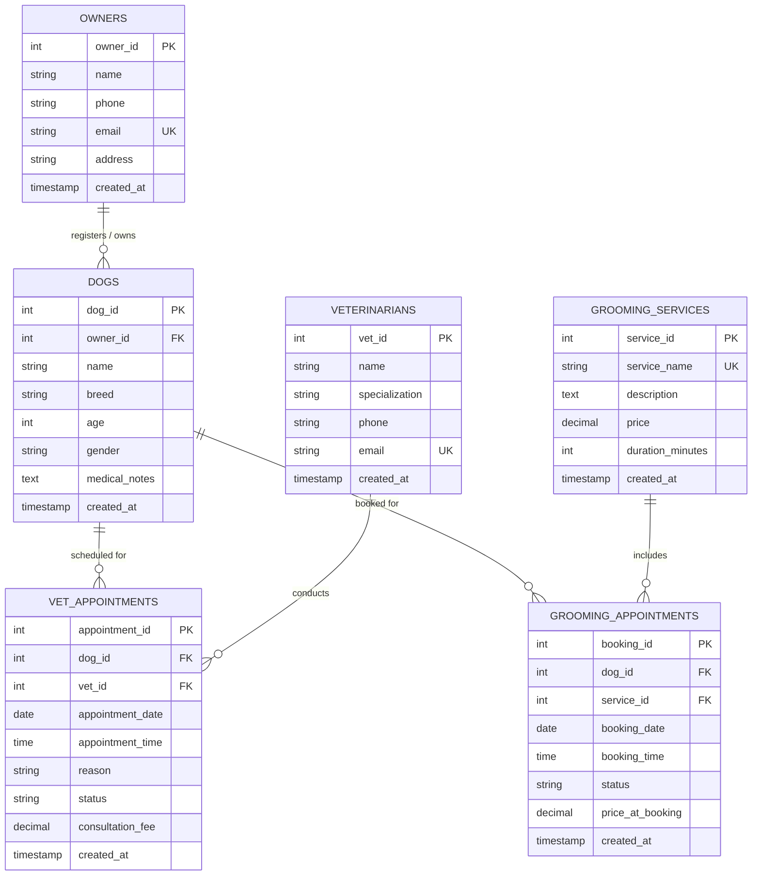

# DBMS Practical Report: Practical 10

**Title:** Implementation of Database Connectivity (JDBC) with Relational Database Management System  
**Project:** PawCare — Dog Grooming and Veterinary Appointment Management System  
**Academic Year:** 2025–2026  
**Subject:** Database Management Systems (DBMS) Practical  

---

## 1. Aim
To design, implement, and demonstrate a menu-driven **Dog Grooming and Veterinary Appointment Management System (PawCare)** using **Java, MySQL, and JDBC**, highlighting relational database concepts including Primary Keys, Foreign Keys, Referential Integrity, SQL JOINs, Aggregate Functions, and Transaction Management.

---

## 2. Problem Statement
Veterinary clinics and pet grooming centers face significant challenges coordinating patient histories, scheduling appointments, preventing double-bookings, tracking service fees, and maintaining referential integrity across pet owners, animals, and attending doctors. 

Without a normalized relational database:
- Veterinary appointments are susceptible to scheduling collisions for the same doctor at the same hour.
- Grooming fees fluctuate without preserving historical pricing snapshots.
- Deleting an owner could inadvertently orphan clinical consultation history.
- Querying pet histories alongside attending veterinarians requires cumbersome manual reconciliation.

A dedicated relational database management system integrated with a Java application via JDBC provides a robust, standardized solution.

---

## 3. Objectives
1. Design a normalized 3NF relational database schema (`pawcare_db`) comprising 6 related tables.
2. Enforce primary keys, unique constraints, foreign keys with `ON DELETE RESTRICT`, and domain check constraints.
3. Establish robust database connectivity using standard JDBC APIs (`DriverManager`, `Connection`, `PreparedStatement`, `ResultSet`).
4. Implement complete CRUD (Create, Read, Update, Delete) operations separated cleanly via the Data Access Object (DAO) pattern.
5. Demonstrate multi-table SQL `INNER JOIN` and `LEFT JOIN` operations combining up to 4 tables.
6. Implement database transaction control (`setAutoCommit(false)`, `commit()`, `rollback()`) to maintain atomic integrity during booking and price snapshotting.
7. Implement business rules:
   - Prevent scheduling appointments in the past.
   - Detect and prevent overlapping appointments for the same veterinarian.
   - Prevent deletion of parent records referenced in active medical or grooming logs.
8. Generate aggregate analytical reports using SQL functions (`COUNT`, `SUM`, `COALESCE`, `GROUP BY`, `ORDER BY`).

---

## 4. Software and Hardware Requirements

### Software Requirements
- **Operating System:** Windows 10/11, Linux, or macOS
- **JDK:** Java SE Development Kit 17 or higher (tested with JDK 25 LTS)
- **Database Server:** MySQL Server 8.0 or 8.4 Community Edition
- **Database Client:** MySQL Workbench 8.0 CE / MySQL Command Line Client
- **JDBC Driver:** MySQL Connector/J 9.2.0 (`com.mysql.cj.jdbc.Driver`)
- **Build / Packaging Tool:** Apache Maven 3.8+ / Standard `javac` CLI

### Hardware Requirements
- **Processor:** Intel Core i3 / AMD Ryzen 3 or higher
- **RAM:** Minimum 4 GB (8 GB recommended)
- **Storage:** 500 MB free hard disk space
- **Display:** 1024 x 768 minimum resolution

---

## 5. Theory of JDBC and Its Components

Java Database Connectivity (JDBC) is a Java standard API that enables Java applications to interact with relational databases independently of any single vendor's database engine.

```
+-------------------------------------------------------------+
|                      Java Application                       |
+-------------------------------------------------------------+
                               |
                               v
+-------------------------------------------------------------+
|                          JDBC API                           |
| (DriverManager, Connection, Statement, PreparedStatement,   |
|  CallableStatement, ResultSet, DatabaseMetaData)           |
+-------------------------------------------------------------+
                               |
                               v
+-------------------------------------------------------------+
|               JDBC Driver (MySQL Connector/J)               |
+-------------------------------------------------------------+
                               |
                               v
+-------------------------------------------------------------+
|                 MySQL Database (pawcare_db)                 |
+-------------------------------------------------------------+
```

### Core JDBC Interfaces and Classes:
1. **`DriverManager`:** Manages a list of database drivers. It matches connection requests from the Java application with the proper database driver using a database URL (`jdbc:mysql://localhost:3306/pawcare_db`).
2. **`Connection`:** Represents an established physical session with the database. It provides methods for creating statements, managing transactions (`setAutoCommit()`, `commit()`, `rollback()`), and inspecting database metadata.
3. **`Statement` vs `PreparedStatement`:**
   - `Statement` executes static SQL queries without parameterization (vulnerable to SQL injection).
   - `PreparedStatement` is precompiled by the database engine. Placeholders (`?`) represent dynamic parameters, preventing SQL injection and optimizing repeated execution. PawCare exclusively uses `PreparedStatement`.
4. **`ResultSet`:** A cursor-based tabular representation of data returned by executing a `SELECT` query (`executeQuery()`).
5. **`SQLException`:** Standard checked exception handling vendor-specific error codes, SQL states, and diagnostic messages.

---

## 6. Entity-Relationship (ER) Diagram Description

The PawCare system models the relationships between owners, dogs, clinicians, services, and appointment bookings:



### Cardinality and Participation:
- **`Owners` to `Dogs` (1 : N):** One owner can register multiple dogs. Each dog must be registered to exactly one owner (`owner_id NOT NULL`).
- **`Dogs` to `VetAppointments` (1 : N):** A dog can have zero or multiple clinical consultations.
- **`Veterinarians` to `VetAppointments` (1 : N):** A veterinarian can consult on multiple appointments.
- **`Dogs` to `GroomingAppointments` (1 : N):** A dog can have zero or multiple grooming bookings.
- **`GroomingServices` to `GroomingAppointments` (1 : N):** A grooming service can be booked across many customer appointments.

---

## 7. Relational Schema

- **Owners** (<ins>owner_id</ins>, name, phone, email, address, created_at)
- **Dogs** (<ins>dog_id</ins>, <mark>owner_id</mark>, name, breed, age, gender, medical_notes, created_at)  
  *FK: owner_id REFERENCES Owners(owner_id)*
- **Veterinarians** (<ins>vet_id</ins>, name, specialization, phone, email, created_at)
- **VetAppointments** (<ins>appointment_id</ins>, <mark>dog_id</mark>, <mark>vet_id</mark>, appointment_date, appointment_time, reason, status, consultation_fee, created_at)  
  *FK1: dog_id REFERENCES Dogs(dog_id)*  
  *FK2: vet_id REFERENCES Veterinarians(vet_id)*
- **GroomingServices** (<ins>service_id</ins>, service_name, description, price, duration_minutes, created_at)
- **GroomingAppointments** (<ins>booking_id</ins>, <mark>dog_id</mark>, <mark>service_id</mark>, booking_date, booking_time, status, price_at_booking, created_at)  
  *FK1: dog_id REFERENCES Dogs(dog_id)*  
  *FK2: service_id REFERENCES GroomingServices(service_id)*

---

## 8. SQL Table Creation Queries

```sql
CREATE DATABASE pawcare_db;
USE pawcare_db;

-- 1. Owners Table
CREATE TABLE Owners (
    owner_id    INT AUTO_INCREMENT PRIMARY KEY,
    name        VARCHAR(100) NOT NULL,
    phone       VARCHAR(15)  NOT NULL,
    email       VARCHAR(100) NOT NULL UNIQUE,
    address     VARCHAR(255),
    created_at  TIMESTAMP DEFAULT CURRENT_TIMESTAMP,
    CONSTRAINT chk_owner_phone CHECK (LENGTH(phone) >= 10)
) ENGINE=InnoDB;

-- 2. Dogs Table
CREATE TABLE Dogs (
    dog_id        INT AUTO_INCREMENT PRIMARY KEY,
    owner_id      INT NOT NULL,
    name          VARCHAR(100) NOT NULL,
    breed         VARCHAR(100),
    age           INT,
    gender        VARCHAR(20),
    medical_notes TEXT,
    created_at    TIMESTAMP DEFAULT CURRENT_TIMESTAMP,
    CONSTRAINT fk_dogs_owner
        FOREIGN KEY (owner_id) REFERENCES Owners(owner_id)
        ON UPDATE CASCADE ON DELETE RESTRICT,
    CONSTRAINT chk_dog_age CHECK (age >= 0 AND age <= 35)
) ENGINE=InnoDB;

-- 3. Veterinarians Table
CREATE TABLE Veterinarians (
    vet_id         INT AUTO_INCREMENT PRIMARY KEY,
    name           VARCHAR(100) NOT NULL,
    specialization VARCHAR(100) NOT NULL,
    phone          VARCHAR(15)  NOT NULL,
    email          VARCHAR(100) NOT NULL UNIQUE,
    created_at     TIMESTAMP DEFAULT CURRENT_TIMESTAMP
) ENGINE=InnoDB;

-- 4. VetAppointments Table
CREATE TABLE VetAppointments (
    appointment_id   INT AUTO_INCREMENT PRIMARY KEY,
    dog_id           INT NOT NULL,
    vet_id           INT NOT NULL,
    appointment_date DATE NOT NULL,
    appointment_time TIME NOT NULL,
    reason           VARCHAR(255) NOT NULL,
    status           VARCHAR(20)  NOT NULL DEFAULT 'Scheduled',
    consultation_fee DECIMAL(10,2) NOT NULL DEFAULT 500.00,
    created_at       TIMESTAMP DEFAULT CURRENT_TIMESTAMP,
    CONSTRAINT fk_vetapp_dog
        FOREIGN KEY (dog_id) REFERENCES Dogs(dog_id)
        ON UPDATE CASCADE ON DELETE RESTRICT,
    CONSTRAINT fk_vetapp_vet
        FOREIGN KEY (vet_id) REFERENCES Veterinarians(vet_id)
        ON UPDATE CASCADE ON DELETE RESTRICT,
    CONSTRAINT chk_vetapp_status
        CHECK (status IN ('Scheduled', 'Completed', 'Cancelled'))
) ENGINE=InnoDB;

CREATE INDEX idx_vet_datetime ON VetAppointments(vet_id, appointment_date, appointment_time);

-- 5. GroomingServices Table
CREATE TABLE GroomingServices (
    service_id       INT AUTO_INCREMENT PRIMARY KEY,
    service_name     VARCHAR(100) NOT NULL UNIQUE,
    description      TEXT,
    price            DECIMAL(10,2) NOT NULL,
    duration_minutes INT NOT NULL,
    created_at       TIMESTAMP DEFAULT CURRENT_TIMESTAMP,
    CONSTRAINT chk_service_price CHECK (price >= 0),
    CONSTRAINT chk_service_duration CHECK (duration_minutes > 0)
) ENGINE=InnoDB;

-- 6. GroomingAppointments Table
CREATE TABLE GroomingAppointments (
    booking_id       INT AUTO_INCREMENT PRIMARY KEY,
    dog_id           INT NOT NULL,
    service_id       INT NOT NULL,
    booking_date     DATE NOT NULL,
    booking_time     TIME NOT NULL,
    status           VARCHAR(20) NOT NULL DEFAULT 'Scheduled',
    price_at_booking DECIMAL(10,2) NOT NULL,
    created_at       TIMESTAMP DEFAULT CURRENT_TIMESTAMP,
    CONSTRAINT fk_groomapp_dog
        FOREIGN KEY (dog_id) REFERENCES Dogs(dog_id)
        ON UPDATE CASCADE ON DELETE RESTRICT,
    CONSTRAINT fk_groomapp_service
        FOREIGN KEY (service_id) REFERENCES GroomingServices(service_id)
        ON UPDATE CASCADE ON DELETE RESTRICT,
    CONSTRAINT chk_groomapp_status
        CHECK (status IN ('Scheduled', 'Completed', 'Cancelled'))
) ENGINE=InnoDB;

CREATE INDEX idx_groom_datetime ON GroomingAppointments(booking_date, booking_time);
```

---

## 9. Java Source Code Overview

The project is structured into clean layers following industry best practices:
1. **`com.pawcare.DBConnection`**: Encapsulates JDBC driver loading (`com.mysql.cj.jdbc.Driver`), credential retrieval from `db.properties`, connection pooling, and connection diagnostics.
2. **`com.pawcare.model`**: Entity classes (`Owner`, `Dog`, `Veterinarian`, `VetAppointment`, `GroomingService`, `GroomingAppointment`) encapsulating data properties.
3. **`com.pawcare.dao`**: Data Access Objects housing parameterized SQL queries. DAOs manage prepared statements, result set extraction, and transaction demarcation.
4. **`com.pawcare.service`**: Menu handlers and user interaction controllers verifying business rules before calling DAOs.
5. **`com.pawcare.util`**: `InputValidator` (regex validation, date parsing, safe integer parsing) and `ConsoleFormatter` (ASCII table rendering).
6. **`com.pawcare.Main`**: Application entry point with ASCII banner, connection health check, and interactive menu loop.

---

## 10. JDBC Connectivity Steps

Demonstrating JDBC connectivity requires 6 core programming steps:

```java
// Step 1: Load and register JDBC Driver
Class.forName("com.mysql.cj.jdbc.Driver");

// Step 2: Establish connection via DriverManager
String url = "jdbc:mysql://localhost:3306/pawcare_db";
Connection conn = DriverManager.getConnection(url, "root", "password");

// Step 3: Create PreparedStatement with parameterized query
String sql = "SELECT * FROM Dogs WHERE owner_id = ?";
PreparedStatement ps = conn.prepareStatement(sql);
ps.setInt(1, 1);

// Step 4: Execute query and receive ResultSet
ResultSet rs = ps.executeQuery();

// Step 5: Process ResultSet rows
while (rs.next()) {
    System.out.println("Dog: " + rs.getString("name"));
}

// Step 6: Close resources safely using try-with-resources
// (Automatically closes ResultSet, PreparedStatement, and Connection)
```

---

## 11. Sample Input and Output

### A. Testing Database Connection
```
--- Testing MySQL JDBC Database Connection ---
JDBC Target URL : jdbc:mysql://localhost:3306/pawcare_db?useSSL=false&allowPublicKeyRetrieval=true&serverTimezone=UTC
Database User   : root
[SUCCESS] Successfully connected to MySQL Database!
DBMS Product    : MySQL v8.0.40
JDBC Driver     : MySQL Connector/J v9.2.0
Active Schema   : pawcare_db
```

### B. Displaying Dogs Joined with Pet Owners (SQL INNER JOIN)
```
  ==> REGISTERED DOGS (WITH OWNERS)
+--------+-------+------------------+---------+--------+------------------+------------------------------------+
| Dog ID | Name  | Breed            | Age     | Gender | Owner Name       | Medical Notes                      |
+--------+-------+------------------+---------+--------+------------------+------------------------------------+
| 1      | Max   | Golden Retriever | 3 yrs   | Male   | Aarav Sharma     | Up to date on vaccinations; mil... |
| 2      | Luna  | Beagle           | 2 yrs   | Female | Aarav Sharma     | Sensitive stomach; requires hyp... |
| 3      | Rocky | German Shepherd  | 4 yrs   | Male   | Priya Patel      | Hip dysplasia monitoring; no st... |
| 4      | Bella | Shih Tzu         | 1 yrs   | Female | Rohan Verma      | Healthy puppy; needs regular co... |
| 5      | Bruno | Rottweiler       | 5 yrs   | Male   | Rohan Verma      | Routine tick & flea preventativ... |
| 6      | Coco  | Poodle           | 2 yrs   | Female | Sneha Mukherjee  | Ear cleaning required due to mo... |
| 7      | Leo   | Labrador         | 6 yrs   | Male   | Vikram Malhotra  | Arthritis in left hind leg; tak... |
+--------+-------+------------------+---------+--------+------------------+------------------------------------+
  Total records: 7
```

### C. Booking Appointment Conflict Prevention (Scheduling Collision)
```
--- [Book Veterinary Appointment] ---
Enter Dog ID: 1
Enter Veterinarian ID: 1
Scheduling appointment for Dog 'Max' with Dr. Aditi Kulkarni
Enter Appointment Date (YYYY-MM-DD): 2026-11-15
Enter Appointment Time (HH:mm, 24-hr): 10:00
Enter Reason for Visit: Dental checkup
Enter Consultation Fee (₹): 600.00

[BOOKING ERROR] Scheduling Conflict: Veterinarian ID 1 already has a scheduled appointment on 2026-11-15 at 10:00:00.
```

### D. Multi-Table Analytical Report: Most Popular Grooming Packages
```
  ==> MOST FREQUENTLY BOOKED GROOMING SERVICES
+------------+-----------------------+------------+--------------+-------------------+
| Service ID | Service Name          | Base Price | Times Booked | Revenue Generated |
+------------+-----------------------+------------+--------------+-------------------+
| 1          | Bath & Blow Dry       | ₹800.00    | 2            | ₹1600.00          |
| 2          | Full Grooming         | ₹1800.00   | 2            | ₹3600.00          |
| 3          | Nail Trimming         | ₹350.00    | 2            | ₹700.00           |
| 4          | Ear & Teeth Hygiene   | ₹500.00    | 1            | ₹500.00           |
| 5          | De-Shedding Treatment | ₹1200.00   | 1            | ₹1200.00          |
+------------+-----------------------+------------+--------------+-------------------+
  Total records: 5
```

---

## 12. Screenshots to Capture During Actual Execution

Capture the following screenshots when running the project for your final submission binder:

1. **Screenshot 1: MySQL Workbench / CLI Table Verification**
   - Execute `SHOW TABLES;` and `DESCRIBE VetAppointments;` in MySQL Workbench showing constraints and data types.
2. **Screenshot 2: Main Application Startup & Connection Test**
   - Console view showing the PawCare ASCII banner and `[SUCCESS] Successfully connected to MySQL Database!`.
3. **Screenshot 3: Pet Owner Registration and Listing**
   - Menu Option 1 -> Submenu Option 1 (Register Owner) followed by Submenu Option 2 (Display All Owners).
4. **Screenshot 4: Dog Registration with Foreign Key Validation**
   - Menu Option 2 -> Registering a new dog under an existing Owner ID.
5. **Screenshot 5: Display Dogs with Owner Names (SQL JOIN)**
   - Menu Option 2 -> Submenu Option 2 showing `Dog Name` and `Owner Name` in the ASCII table.
6. **Screenshot 6: Booking a Veterinary Appointment**
   - Menu Option 4 -> Successfully booking an appointment for a dog with Dr. Aditi Kulkarni.
7. **Screenshot 7: Double-Booking Conflict Prevention**
   - Menu Option 4 -> Attempting to book the same veterinarian for the identical date and time slot.
8. **Screenshot 8: Referential Integrity Enforcement (Safe Deletion)**
   - Menu Option 1 -> Attempting to delete an owner who has registered dogs, showing the `FOREIGN KEY RESTRICTION` error message.
9. **Screenshot 9: Analytical Reports Suite**
   - Menu Option 7 -> Submenu Option 7 (Run All Reports) displaying system metrics, status breakdown, and realized revenue.

---

## 13. Testing and Results

| Test Case ID | Test Scenario | Input Given | Expected Result | Actual Result | Status |
|---|---|---|---|---|---|
| **TC-01** | Database Connectivity | Valid `db.properties` credentials | Connection established; metadata printed | Connected with MySQL 8.0 & JDBC driver v9.2.0 | **PASS** |
| **TC-02** | Register Pet Owner | Name, 10-digit phone, valid email | Row inserted; auto-increment ID returned | Owner registered with ID 10 | **PASS** |
| **TC-03** | Duplicate Email Rejection | Pre-existing email address | Handled gracefully with SQL duplicate error | Rejected; error displayed to user | **PASS** |
| **TC-04** | Register Dog under Invalid Owner | Owner ID: 9999 (Non-existent) | Pre-validation warning before insert | Warns "Owner ID 9999 does not exist" | **PASS** |
| **TC-05** | View Dogs with SQL JOIN | Select All Dogs | Displays dog rows joined with owner names | Table displayed with owner names | **PASS** |
| **TC-06** | Reject Appointment in Past | Date: `2020-01-01` | Validation rejects past date | Console rejects date; re-prompts user | **PASS** |
| **TC-07** | Double-Booking Prevention | Same vet, identical date and time | Pre-booking conflict query triggers | Conflict error printed; booking aborted | **PASS** |
| **TC-08** | Transactional Price Snapshot | Book grooming session | Service price snapshotted into booking table | Correct price saved in booking row | **PASS** |
| **TC-09** | Safe Deletion (FK Restrict) | Delete Owner with registered dogs | Prevented before or during deletion | Prevented with clear referential explanation | **PASS** |
| **TC-10** | Revenue Aggregation Report | Select Option 7 -> 6 | Sum of completed consultation and grooming fees | Accurately calculates total realized revenue | **PASS** |

---

## 14. Conclusion
The PawCare Dog Grooming and Veterinary Appointment Management System was successfully developed and tested. The project demonstrates the practical application of relational database concepts through Java and JDBC. By avoiding complex abstractions like ORMs, the direct usage of `PreparedStatement`, `ResultSet`, multi-table JOINs, and transactions was explicitly realized. The system guarantees referential integrity, prevents double-booking anomalies, and delivers essential business analytics, making it fully compliant with college DBMS practical examination standards.
